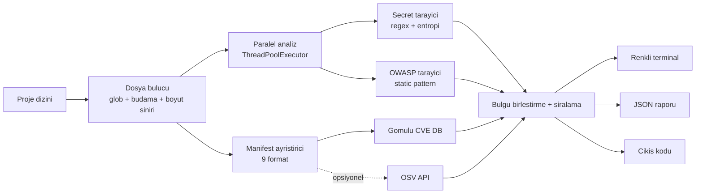

# sec-audit-cli

<p align="center">
  
  
  
  
  
</p>

<p align="center">
  <b>Tek komutla gizli anahtarları, zafiyetli paketleri ve OWASP risklerini tara.<br>
  Renkli terminal çıktısı + makine tarafından okunabilir JSON raporu.</b>
</p>

---

## Neden sec-audit-cli?

Bir projeyi klonladınız ve sıradaki adımda şunu mu diyorsunuz: *"Acaba burada `.env` içinde API anahtarı var mı, `requirements.txt` bilinen bir CVE içeriyor mu, kodda `eval(` var mı?"*

`sec-audit-cli` bu üç soruyu **tek komutla**, **saniyeler içinde** yanıtlar. Harici servise ihtiyaç duymaz (opsiyonel OSV modu dışında), **sıfır çalışma zamanı bağımlılığı** ile çalışır ve CI pipeline'ına doğrudan entegre olur.

| Özellik | Açıklama |
|---|---|
| **Secret taraması** | AWS, GitHub, OpenAI, Stripe, Slack, Google, JWT, PEM, genel credential atamaları + Shannon entropisi |
| **Bağımlılık denetimi** | 9 ekosistem/format desteği, gömülü CVE veritabanı, opsiyonel [OSV](https://osv.dev/) API sorgusu |
| **OWASP denetimi** | Injection, XSS, SSRF, path traversal, weak crypto, debug mode, XXE ve daha fazlası |
| **Güvenli çıktı** | Bulunan gizli anahtarlar asla düz metin gösterilmez; maskelenir ve SHA-256 parmak izi eklenir |
| **Hız** | Paralel dosya analizi (thread pool), ikili dosya atlama, boyut sınırı, dizin budama |
| **CI dostu** | `--fail-on` eşikleri, deterministik JSON, anlamlı çıkış kodları |

---

## Kurulum

```bash
git clone https://github.com/yazilimbaysoz-svg/sec-audit-cli.git
cd sec-audit-cli
uv venv
uv pip install -e .
source .venv/bin/activate
sec-audit --version
```

> **Not:** `uv` yoksa `pip install uv` ile kurabilirsiniz. Araç Python 3.11+ gerektirir.

---

## Hızlı başlangıç

```bash
# Renkli terminal raporu
sec-audit .

# JSON raporunu ekrana yazdır
sec-audit . --json

# JSON raporunu dosyaya kaydet
sec-audit . --output sec-audit-report.json

# Sadece yüksek ve kritik bulgularda başarısız ol (CI için ideal)
sec-audit . --fail-on high

# OSV veritabanı ile çevrimiçi derin tarama
sec-audit . --online --fail-on medium
```

### Örnek terminal çıktısı

```text
========================================================================
  sec-audit-cli v0.1.0  |  /home/user/projects/payment-api
  38 ms  |  4 finding(s)
========================================================================
  CRITICAL: 1   HIGH: 1   MEDIUM: 1   LOW: 1

  X CRITICAL (1)
    SEC-OAI-001  OpenAI API key
    config.py:12:21
    fix: Move this value to a secret manager or environment variable and rotate it immediately.

  ! HIGH (1)
    DEP-CVE-2023-32681  requests 2.30.0: Proxy-Authorization header leaked...
    requirements.txt:4:1
    fix: Upgrade requests to 2.31.0 or newer.

  ~ MEDIUM (1)
    OWASP-A02-HASH  Weak hashing algorithm
    auth.py:31:5
    fix: Use SHA-256 or Argon2/bcrypt for passwords instead of MD5 or SHA-1.
```

---

## Tüm seçenekler

```text
usage: sec-audit [-h] [--json] [-o FILE] [--fail-on {info,low,medium,high,critical,none}]
                 [--min-severity {info,low,medium,high,critical}] [--exclude GLOB]
                 [--include GLOB] [--max-file-size MB] [--online] [--no-color]
                 [-q] [--version] [path]
```

| Seçenek | Açıklama |
|---|---|
| `path` | Taranacak proje dizini (varsayılan: `.`) |
| `--json` | JSON raporunu stdout'a yazdır |
| `-o, --output` | JSON raporunu dosyaya yaz |
| `--fail-on` | Bu seviye ve üstü bulgu varsa çıkış kodu `1` (varsayılan: `high`) |
| `--min-severity` | Altındaki bulguları gizle |
| `--exclude` | Glob ile yolları hariç tut (tekrarlanabilir) |
| `--include` | Sadece eşleşen yolları tara (tekrarlanabilir) |
| `--max-file-size` | MB cinsinden dosya boyutu sınırı (varsayılan: `5`) |
| `--online` | OSV API üzerinden ek zafiyet sorgusu yap |
| `--no-color` | ANSI renklerini kapat |
| `-q, --quiet` | Sadece özet satırı |

### Çıkış kodları

| Kod | Anlamı |
|---|---|
| `0` | Eşik altında bulgu yok / temiz tarama |
| `1` | `--fail-on` eşiğinde veya üstünde bulgu var |
| `2` | Geçersiz yol veya I/O hatası |
| `130` | Kullanıcı tarafından durduruldu |

---

## JSON rapor şeması

```json
{
  "schema_version": "1.0",
  "tool": "sec-audit-cli",
  "version": "0.1.0",
  "timestamp": "2026-11-20T12:00:00+00:00",
  "scan_path": "/home/user/project",
  "duration_ms": 38.42,
  "summary": {
    "total": 2,
    "by_severity": {"INFO": 0, "LOW": 0, "MEDIUM": 1, "HIGH": 1, "CRITICAL": 0},
    "clean": false
  },
  "config": {"online": false, "fail_on": "high"},
  "findings": [
    {
      "rule_id": "SEC-GIT-001",
      "title": "GitHub access token",
      "severity": "CRITICAL",
      "category": "secret",
      "file": "config.py",
      "line": 9,
      "column": 18,
      "evidence": "ghp_********************cDeF [sha256:1a2b3c4d]",
      "remediation": "Move this value to a secret manager...",
      "cwe": "CWE-798",
      "owasp": "A07:2021 Identification and Authentication Failures",
      "source": "regex+entropy"
    }
  ]
}
```

---

## Desteklenen tarama kaynakları

**Secret kuralları:** `SEC-AWS`, `SEC-GIT`, `SEC-OAI`, `SEC-STR`, `SEC-SLK`, `SEC-GCP`, `SEC-PEM`, `SEC-JWT`, `SEC-GEN`, `SEC-ENV`

**Bağımlılık formatları:** `requirements*.txt`, `pyproject.toml` (PEP 621 + Poetry), `Pipfile.lock`, `package.json`, `package-lock.json`, `yarn.lock`, `Cargo.lock`, `go.mod`

**OWASP kuralları:** SQLi, command injection, XSS, unsafe deserialization, TLS doğrulama, zayıf hash, SSRF, path traversal, debug mode, XXE, localStorage token, dependency integrity

Varsayılan olarak `.git`, `node_modules`, `.venv`, `__pycache__`, `dist`, `build`, `target`, `vendor` gibi dizinler atlanır.

---

## CI entegrasyonu

```yaml
- name: Guvenlik taramasi
  run: |
    uv venv
    uv pip install sec-audit-cli
    uv run sec-audit . --fail-on high --output sec-audit-report.json

- name: Raporu yukle
  if: always()
  uses: actions/upload-artifact@v4
  with:
    name: sec-audit-report
    path: sec-audit-report.json
```

---

## Mimari



---

## Gelistirme

```bash
uv venv
uv pip install -e '.[dev]'
uv run pytest --cov=sec_audit --cov-report=term-missing
uv run ruff check src tests
semgrep scan --config semgrep-rules.yml --error src tests
```

Testler tamamen çevrimdışıdır; ağ erişimi gerektirmez.

---

## Güvenlik notu

`sec-audit-cli` bulduğu gizli anahtarları **asla** ham olarak yazdırmaz. Terminal ve JSON çıktısında yalnızca ilk/son 4 karakter, yıldız maskesi ve SHA-256 parmak izi bulunur. Yine de rapor dosyalarını depoya eklemeyin (`.gitignore` örnekleri mevcuttur).

---

## Yol haritası

- [x] Gizli anahtar, bağımlılık ve OWASP taraması
- [x] JSON raporu, renkli terminal, CI çıkış kodları
- [x] Opsiyonel OSV entegrasyonu
- [ ] SARIF çıktısı (GitHub Code Scanning)
- [ ] `.secauditignore` dosyası desteği
- [ ] Git geçmişi (commit bazlı) taraması

---

## Lisans

MIT © 2026 Baysoz Yazilim.

<p align="center">
  <sub>Yildizlamak en buyuk motivasyon kaynagimiz.</sub>
</p>
